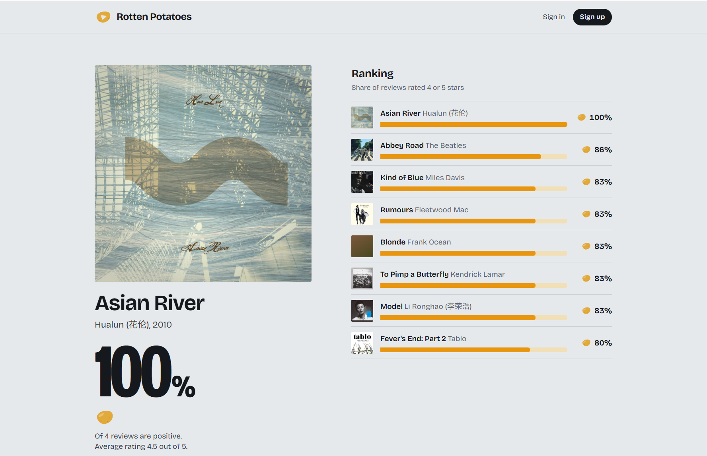

# Rotten Potatoes

A music review platform: browse albums, see a ranking based on how many reviewers liked each one, and sign in to rate and review.

**Live demo:** https://frontend.bravesky-ab4bf45a.centralus.azurecontainerapps.io
Sign in with `alice` / `demo12345`, or register your own account. The first request after a quiet period can take a few seconds while the app wakes up.



## Features

- Album ranking by share of positive reviews, plus a grid of all albums
- Album detail page with cover art, track list and reviews
- Register and sign in (JWT); write, edit and delete your own review (1 to 5 stars)
- Light and dark theme, following the system setting

## Tech stack

| Layer | Used |
| --- | --- |
| Backend | Java 21, Spring Boot 4, Spring Security, MyBatis, JWT |
| Database | PostgreSQL 16 |
| Frontend | React 19, Vite |
| Serving | nginx (static files, API proxy, 30 second cache for the ranking) |
| Deploy | Docker, Azure Container Apps, Azure Container Registry, Azure Database for PostgreSQL |
| Tests | JUnit 5, Mockito, Testcontainers |

```
Browser ──> nginx (React build) ──/api──> Spring Boot ──> PostgreSQL
```

## Run it locally

You need Docker. The whole stack:

```
docker compose --profile app up --build
```

Open http://localhost:8081. A fresh database is filled with sample albums, users and reviews (all sample data; every demo user has the password `demo12345`).

For development, start only the database and run the two apps yourself (Java 21, Maven, Node):

```
docker compose up -d postgres
cd backend && mvn spring-boot:run
cd frontend && npm install && npm run dev
```

The API is at http://localhost:8080 and the dev site at http://localhost:5173.

## API

| Method | Path | Notes |
| --- | --- | --- |
| POST | `/api/auth/register`, `/api/auth/login` | returns a JWT |
| GET | `/api/albums/stats` | albums with review counts and ratings |
| GET | `/api/albums/{id}` | one album with its tracks |
| GET | `/api/ranking?limit=` | albums ordered by positive rate |
| GET | `/api/albums/{albumId}/reviews` | reviews of an album |
| POST | `/api/albums/{albumId}/reviews` | sign in required |
| DELETE | `/api/reviews/{id}` | sign in required, own reviews only |

## Tests

```
cd backend && mvn test
```

Unit tests cover JWT handling and the review rules. An integration test starts a real PostgreSQL in a container (Docker must be running) and walks through register, login and review.

## Deployment

See [docs/azure-deploy.md](docs/azure-deploy.md) for the step by step Azure setup and the problems met along the way.

## Notes

- Reviews and users are made-up sample data. Cover art and previews come from the iTunes Search API.
- Planned: pagination and search, password reset, GitHub Actions for CI.
